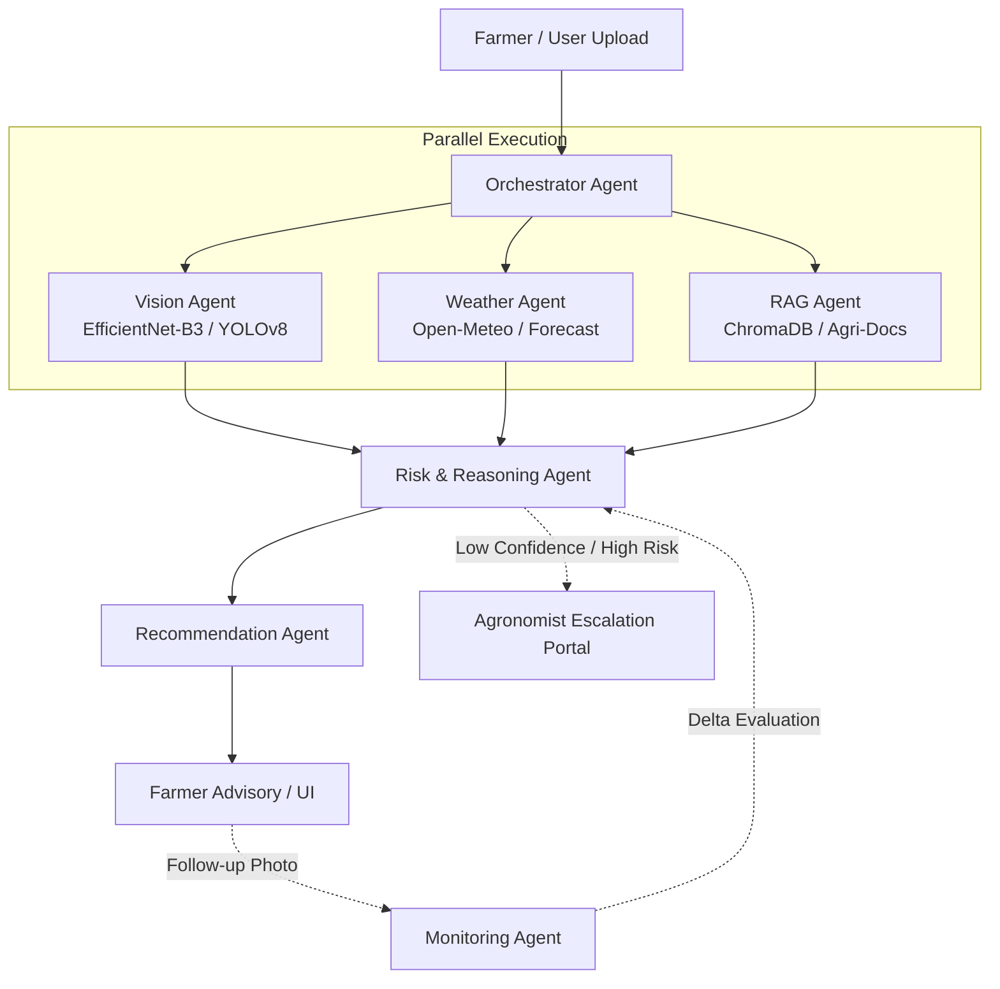

# 🍃 LeafMind: Multi-Agent Crop Leaf Disease Detection & Farmer Advisory

[](https://www.python.org/)
[](https://github.com/langchain-ai/langgraph)
[](https://pytorch.org/)
[](https://fastapi.tiangolo.com/)
[](LICENSE)

An intelligent, modular multi-agent system providing rapid crop disease identification, real-time meteorological risk analysis, RAG-grounded treatment recommendations, and closed-loop treatment efficacy monitoring for smallholder farmers and agronomists.

---

## 📌 Overview

Crop diseases cause 20–40% of global harvest losses annually. Smallholder farmers frequently face late diagnoses, inaccessible expert agronomists, and severe misidentification risks that lead to misapplied chemicals and crop failure. 

**LeafMind** addresses these challenges using an Orchestrator-Specialist multi-agent framework:
- **Fast Visual Triage:** High-throughput leaf image classification and lesion detection with calibrated confidence.
- **Environmental Context Integration:** Combines real-time micro-climate weather forecasts to evaluate disease proliferation risks.
- **Scientifically Grounded Advisory:** Domain-specific Retrieval-Augmented Generation (RAG) strictly grounded in peer-reviewed agricultural extension guidelines.
- **Closed-Loop Follow-ups:** Long-term case monitoring to track disease progression and evaluate treatment response over time.
- **Human-in-the-Loop Safeguards:** Automated fallback and escalation triggers routing uncertain or high-risk cases to human agronomists.

---

## 📊 Datasets

The machine learning models in LeafMind are built upon and benchmarked against the following datasets:

| Dataset | Type | Description | Link |
| :--- | :--- | :--- | :--- |
| **PlantDoc Object Detection Dataset** | Bounding Box Detection | Field-annotated leaf and disease bounding boxes across diverse crops and outdoor lighting conditions. | [🔗 PlantDoc on Kaggle](https://www.kaggle.com/datasets/yusufmurtaza01/plantdoc-object-detection-dataset) |
| **PlantLab2Real Generalization Benchmark** | Fine-grained Classification | Multi-split benchmark (Train, Val, In-Distribution Test, Out-of-Distribution Test, and Few-Shot) assessing laboratory-to-field generalization. | [🔗 PlantLab2Real on Kaggle](https://www.kaggle.com/datasets/maciekpopik/plantlab2realgeneralization) |

> ⚠️ **Data Integrity Note:** A dedicated deduplication and data-leakage audit pipeline ensures no image byte-overlap or split contamination between training sets and out-of-distribution evaluations.

---

## 🤖 Multi-Agent Architecture

LeafMind decouples domain responsibilities across specialized, cooperative agents orchestrated via **LangGraph**:



### Agent Roles & Responsibilities

1. **Orchestrator Agent:** Coordinates workflow execution, state persistence (SQLite / LangGraph Checkpoints), case ID lifecycle, and parallel agent dispatch.
2. **Vision Agent:** Performs image quality checks, leaf disease classification (EfficientNet-B3), and optional localization (YOLOv8s), yielding calibrated probabilities and uncertainty metrics.
3. **Weather Agent:** Pulls current and 7-day weather metrics (temperature, relative humidity, precipitation, leaf wetness hours) via Open-Meteo with caching and fallback.
4. **RAG Agent:** Performs semantic retrieval across curated agricultural extension manuals, pesticide registries, and management guides using `sentence-transformers` and ChromaDB.
5. **Risk & Reasoning Agent:** Synthesizes pathogen threat tier, micro-climate favorability, and past crop history into a composite risk score ($R = 0.70 \times \text{Threat} + 0.20 \times \text{Weather} + 0.10 \times \text{History}$).
6. **Recommendation Agent:** Generates actionable, plain-language advisory (chemical/biological treatments, non-chemical cultural practices, dosage, safety intervals) with urgency tiers.
7. **Monitoring Agent:** Aligns follow-up images with historical case baselines, tracking symptom trajectory and triggering alerts if disease progression persists.

---

## 🛠️ Tech Stack

- **Core & Runtime:** Python 3.11
- **Machine Learning & Vision:** PyTorch, `timm` (EfficientNet-B3), `ultralytics` (YOLOv8), Pillow
- **Agent Orchestration:** LangGraph, Pydantic v2
- **Vector Database & RAG:** ChromaDB, `sentence-transformers` (`all-MiniLM-L6-v2`), Cross-Encoder Reranker (`ms-marco-MiniLM-L-6-v2`)
- **LLM Synthesis:** Google Gemini (`gemini-1.5-flash`) or Local Ollama (`llama3`) via provider abstraction
- **Backend & APIs:** FastAPI, Uvicorn, HTTPX
- **User Interface:** Streamlit (Farmer & Agronomist review dashboards)
- **Persistence:** SQLite (`checkpoints.db` & JSON case stores)

---

## 📁 Repository Structure

```
LeafMind/
├── Dataset/                     # PlantDoc object detection dataset
├── Dataset_2/                   # PlantLab2Real classification splits
├── docs/
│   ├── dataset_audit.md         # Comprehensive distribution & overlap audit
│   ├── ppt_extract.md           # Requirements and architecture extraction
│   └── spec/                    # Detailed technical specifications (Parts 1-6)
│       ├── part1_audit.md
│       ├── part2_ml_knowledge.md
│       ├── part3_agents.md
│       ├── part4_decision_logic.md
│       ├── part5_eval_stack_roadmap.md
│       └── part6_build_spec.md
├── scripts/
│   └── inspect/                 # Dataset inspection and verification utilities
├── plan.md                      # Living project roadmap and milestone tracker
├── .gitignore
└── README.md
```

---

## 🚀 Getting Started

### 1. Prerequisites
- Python 3.11+
- CUDA-compatible GPU (recommended for PyTorch model training and inference)

### 2. Environment Setup

Clone the repository and create a virtual environment:

```bash
git clone https://github.com/RAIDxVIPER/LeafMind.git
cd LeafMind
python -m venv venv
# Windows:
.\venv\Scripts\activate
# Linux/macOS:
source venv/bin/activate
```

Install core dependencies:

```bash
pip install torch torchvision --index-url https://download.pytorch.org/whl/cu121
pip install timm ultralytics pydantic fastapi uvicorn streamlit chromadb sentence-transformers langgraph httpx python-dotenv
```

### 3. Configuration (.env)

Create a `.env` file in the root directory based on the following template:

```env
# LLM Provider: "gemini" or "ollama"
LLM_PROVIDER=gemini

# Google Gemini API Key (if LLM_PROVIDER=gemini)
GEMINI_API_KEY=your_gemini_api_key_here

# Ollama Settings (if LLM_PROVIDER=ollama)
OLLAMA_BASE_URL=http://localhost:11434
OLLAMA_MODEL=llama3

# Weather API
OPENWEATHERMAP_API_KEY=your_openweathermap_api_key_here # Optional backup (Open-Meteo requires no key)

# Storage paths
CASE_STORE_PATH=data/cases
CHECKPOINT_DB_PATH=data/checkpoints.db
VECTOR_DB_PATH=vector_db/
```

---

## 📈 Roadmap & Milestones

- [x] **Part 1:** Domain extraction, architecture verification, and comprehensive dataset leakage audit.
- [x] **Part 2:** ML model specifications, temperature calibration design, and RAG knowledge architecture.
- [x] **Part 3:** Agent contracts, Pydantic schemas, and LangGraph workflow definition.
- [x] **Part 4:** Decision & risk synthesis logic, escalation triggers (T1–T11), and monitoring rules.
- [x] **Part 5:** Evaluation protocols, deployment stack, and modular directory design.
- [x] **Part 6:** Research validity review, constraint registers, and final implementation blueprint.
- [x] **C1 — Data Prep:** Manifest generation, perceptual deduplication, split leakage audit, class maps, and threat tier definitions.
- [x] **C2 — Vision Model:** EfficientNet-B3 classifier training, temperature calibration (model of record: `checkpoints/run1`), crop-masked inference, and OOD diagnostics.
- [x] **C3 — RAG Agent:** Agricultural knowledge retrieval across 6 crop manuals (441 chunks, 63 chapters), FAISS vector store, exact candidate metadata matching, verification tagging (V1–V3), and 100% grounded extractive assembly (no LLM generation).
- [x] **C4 — Weather Agent:** Micro-climate meteorological fetching (Open-Meteo primary, OpenWeatherMap backup interface), geocoding with ambiguity resolution, default region fallback, leaf-wetness proxy [ENG proxy], in-memory LRU caching with 30m TTL & 24h stale fallback, rules W01–W08 with unverified thresholds [UNVERIFIED — I14], and Part 4 weather score computation.
- [ ] **C5 — Risk & Reasoning Agent:** Pathogen threat tiering, meteorological favorability, and composite scoring (Planned).
- [ ] **C6 — Recommendation Agent:** Plain-language treatment advisory, chemical/cultural guidance, and safety intervals (Planned).
- [ ] **C7 — Orchestrator Agent:** LangGraph state machine, case lifecycle, SQLite persistence, and parallel agent dispatch (Planned).
- [ ] **C8 — Monitoring Agent:** Longitudinal follow-up comparison, symptom progression tracking, and escalation alerts (Planned).
- [ ] **C9 — API & UI:** FastAPI backend and Streamlit farmer/agronomist dashboard (Planned).
- [ ] **C10 — Evaluation Suite:** End-to-end evaluation, benchmark reporting, and reliability tests (Planned).
- [ ] **C11 — Containerization & Deployment:** Docker multi-container environment and deployment hardening (Planned).

---

## 📜 Citation & Credits

If you use this project or research specification, please cite:

- **PlantDoc Dataset:** [Kaggle Dataset](https://www.kaggle.com/datasets/yusufmurtaza01/plantdoc-object-detection-dataset) · Singh et al., *PlantDoc: A Dataset for Visual Plant Disease Detection in the Wild*, 2019.
- **PlantLab2Real Dataset:** [Kaggle Dataset](https://www.kaggle.com/datasets/maciekpopik/plantlab2realgeneralization) · Popik et al., *Benchmarking Plant Disease Recognition Across Domain Shifts*.
