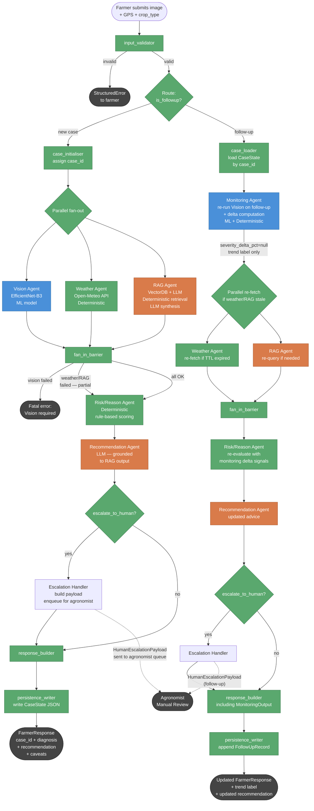

# LeafMind Technical Specification — Part 3: Agents, Schemas, Orchestration
Tags: [PPT]=explicit in slides | [DATA]=verified from datasets | [ENG]=engineering proposal | [GAP]=missing or ambiguous
Date: 2026-10-01

Component type notation used throughout:
  **ML model** = trained neural network, deterministic at inference given weights and input
  **LLM** = large language model called via API; non-deterministic; use only where natural-language generation is necessary
  **Deterministic** = rule-based or algorithmic logic; no learned parameters; fully reproducible given the same inputs

Principle [ENG]: LLM use must be justified. Every component defaults to deterministic unless natural-language generation or open-ended reasoning is explicitly required and cannot be replaced by structured rules.

---

## PPT Architecture Mismatches and Gaps Found During Part 3 Specification

The following discrepancies were identified between the PPT description and the reality established in Parts 1–2. Each is noted in-line in the relevant section and collected here for visibility.

| Ref | PPT claim | Reality / Gap | Action |
|-----|-----------|---------------|--------|
| M01 | Vision Agent outputs "severity estimate (% leaf area affected)" [PPT Slide 5] | Severity is UNSUPPORTED by current data [DATA]; severity_pct = null in all schemas | Downstream agents (Risk, Recommendation, Monitoring) must not read severity; use confidence + detection presence instead |
| M02 | RAG Agent input = "disease label from Vision Agent" [PPT Slide 6] | Too narrow: Risk/Reason Agent also needs weather context to personalise treatment urgency; the RAG Agent still takes only the disease label, but the Risk agent uses both RAG output and weather together | No schema change to RAG Agent; Risk/Reason Agent is the synthesis point |
| M03 | Weather Agent: "current + 7-day forecast" output [PPT Slide 6] | Risk/Reason Agent only needs current conditions + disease-risk flags, not raw 7-day data; the full forecast is computed once and stored in case state but the Risk agent receives only the pre-processed flags | Weather output schema carries both; Risk input schema takes only current + flags |
| M04 | Monitoring Agent "computes % change in affected area" [PPT Slide 8] | No paired severity ground truth exists [DATA]; numeric delta is unsupported; Monitoring instead computes confidence-based change signal and detector presence-change signal | Monitoring output carries delta_signals, not severity_delta_pct |
| M05 | PPT shows Vision / Weather / RAG running in parallel in 0–2s [PPT Slide 9] | This is a design target [PPT]; actual latency depends on model inference time, API round-trip time, and hardware; not experimentally verified | All latency figures in this spec are targets only [ENG]; no measured numbers |
| M06 | PPT implies a single Vision Agent performing both classification and detection simultaneously | Part 1 established two separate models (EfficientNet-B3 classifier + YOLOv8s detector) on different datasets; the Vision Agent wraps both calls but must not conflate their outputs | Vision Agent internal design section covers this |
| M07 | PPT mentions "soil conditions" and "crop growth stage" as inputs to environmental context [PPT Slide 3] | No soil or growth-stage data exists in either dataset and no API is specified [GAP]; these inputs are absent from all schemas until data is acquired | Log as I15 |
| M08 | Recommendation Agent outputs "structured JSON for UI" with cost estimates [PPT Slides 7, 47] | RAG knowledge base does not yet exist [GAP]; cost fields are null until documents are collected | cost_estimate: null in schema with explanation note |

---

## 3a. Per-Agent Specifications

---

### 3a-1. Orchestrator Agent

**Component type**: Deterministic

**Justification**: The Orchestrator performs routing, logging, state management, and parallel dispatch. None of these tasks require language generation or open-ended reasoning. LLM would add cost, latency, and non-determinism without benefit. [ENG]

**Purpose**: Receives the initial farmer request or follow-up submission. Assigns a unique case_id. Dispatches Vision, Weather, and RAG agents in parallel (initial path) or dispatches Monitoring Agent (follow-up path). Collects results, passes them to Risk/Reason Agent, and returns the final response to the farmer. Persists case state.

**Input schema**: `FarmerRequest` (see 3b)

**Processing logic**:
```
1. Validate input: image present, GPS coordinates in range, mime-type acceptable
2. Determine path:
   a. is_followup == False → NEW CASE path
      - Generate case_id (UUID4)
      - Write initial case record to persistence layer
      - Fan-out: asyncio.gather(vision_agent, weather_agent, rag_agent)
      - Await all three (with per-branch timeout and failure handling — see 3c)
      - Pass collected outputs to risk_reason_agent
      - Pass risk output to recommendation_agent
      - Write completed case to persistence
      - Return FarmerResponse
   b. is_followup == True → FOLLOW-UP path
      - Load existing case by case_id; verify farmer_id matches
      - Dispatch monitoring_agent(image, case_history)
      - Pass monitoring output + existing diagnosis to risk_reason_agent (re-evaluation)
      - Pass updated risk to recommendation_agent
      - Append follow-up record to case history
      - Return updated FarmerResponse
3. On any unrecoverable error: return StructuredError to caller; never crash silently
```

**Model/API/Tool**: LangGraph state graph (node: `orchestrator`); asyncio for parallel dispatch; UUID for case_id; SQLite or file-based JSON persistence (Phase 1) [ENG]

**Output schema**: `FarmerResponse` (final) or `EscalationPayload` (when escalation triggered)

**Failure conditions**:
- Invalid image → return 400-equivalent StructuredError immediately; do not dispatch agents
- All three parallel branches fail → return StructuredError; log to monitoring
- Partial branch failures → proceed with available outputs; set `partial_result=True` in response

**Uncertainty handling**: Does not generate uncertainty itself; propagates `escalate_to_human` flag from downstream agents to response

**Dependencies**: Vision Agent, Weather Agent, RAG Agent, Risk/Reason Agent, Recommendation Agent, persistence layer

**Example input**:
```json
{
  "farmer_id": "farmer_001",
  "image_bytes": "<base64-encoded JPEG>",
  "image_mime_type": "image/jpeg",
  "gps_lat": 13.082,
  "gps_lon": 80.270,
  "crop_type": "Tomato",
  "submitted_at": "2026-10-01T18:30:00Z",
  "is_followup": false,
  "case_id": null
}
```

**Example output** (abbreviated):
```json
{
  "case_id": "550e8400-e29b-41d4-a716-446655440000",
  "submitted_at": "2026-10-01T18:30:00Z",
  "vision": { "top_label": "Tomato___Early_blight", "confidence": 0.83, "severity_pct": null },
  "risk": { "risk_level": "moderate", "risk_score": 0.61, "factors": [...] },
  "recommendation": { "actions": [...], "urgency": "within_48h", "citations": [...] },
  "escalate_to_human": false,
  "partial_result": false
}
```

---

### 3a-2. Vision Agent

**Component type**: ML model (two sub-models: EfficientNet-B3 classifier + optional YOLOv8s detector)

**Justification**: Image classification and object detection are canonical ML tasks well-served by convolutional neural networks. LLM is inappropriate for pixel-level classification. [ENG][DATA]

**Purpose**: Receives a farmer leaf image. Runs the primary EfficientNet-B3 30-class classifier to identify the disease. Optionally runs the YOLOv8s leaf detector (D1-trained) if the image is a scene (multiple leaves visible) rather than a close-up. Returns a structured VisionOutput with the classification result, top-k probabilities, calibrated confidence, image-quality flags, and severity=null.

**Input schema**: `VisionInput` (see 3b)

**Processing logic**:
```
1. Validate image: decode, check dimensions, detect corruption
2. Set image_quality_flags:
   - low_resolution if max(W, H) < 200px
   - blurry if Laplacian variance < threshold_to_be_calibrated [ENG assumption]
   - non_leaf_suspected: placeholder (heuristic; no dedicated model)
3. Convert to RGB (handle CMYK, RGBA, L modes)
4. Resize + normalize for EfficientNet-B3 (224×224, ImageNet mean/std)
5. Run classifier:
   - Get logits; apply temperature T (from calibration artifact)
   - Compute softmax probabilities
   - top_label = argmax; confidence = max(probs)
   - top_k_probs = top-5 (label, prob) pairs
   - ood_flag = (confidence < 0.40) [ENG assumption — not calibrated]
6. Optionally run YOLOv8s detector (if image appears to be a scene):
   - Detection scene heuristic: if confidence < 0.50 or image_area > 1 Mpx [ENG assumption]
   - Run YOLOv8s on resized 640×640 image
   - Output: list of detected leaf boxes (class_id, bbox, conf per box)
   - leaf_detected = (any box with conf > 0.25)
7. Severity: set severity_pct = null; set severity_note = standard explanation string
8. Escalate flag: escalate_to_human = (confidence < 0.60) OR ((top_k_probs[0].prob - top_k_probs[1].prob) < 0.15)
   [ENG assumption — values to be calibrated on D2_Val; see Part 2]
9. Return VisionOutput
```

**Model/API/Tool**: EfficientNet-B3 (torchvision/timm, ImageNet pretrained, fine-tuned on D2_Train); YOLOv8s (ultralytics, COCO pretrained, fine-tuned on D1_train); PIL/Pillow for image handling; temperature scalar from calibration [ENG]

**Output schema**: `VisionOutput` (see 3b)

**Failure conditions**:
- Cannot decode image → raise `VisionError(code="invalid_image")`
- Model file missing / corrupt → raise `VisionError(code="model_unavailable")`
- Image too small to classify reliably → set low_resolution=True; proceed with low confidence; escalate

**Uncertainty handling**: Temperature-scaled softmax provides calibrated probabilities. `ood_flag` signals when the image is unlike the training distribution. `escalate_to_human` is set when confidence is too low for automated action. Top-k probs allow Risk agent to see runner-up candidates.

**Dependencies**: EfficientNet-B3 checkpoint + temperature scalar; YOLOv8s checkpoint (optional); Pillow; torchvision/timm; ultralytics

**Example input**:
```json
{ "image_bytes": "<base64 JPEG>", "image_mime_type": "image/jpeg" }
```

**Example output**:
```json
{
  "top_label": "Tomato___Early_blight",
  "confidence": 0.83,
  "top_k_probs": [
    {"label": "Tomato___Early_blight", "prob": 0.83},
    {"label": "Tomato___Late_blight",  "prob": 0.09},
    {"label": "Tomato___Septoria_leaf_spot", "prob": 0.04},
    {"label": "Tomato___Bacterial_spot", "prob": 0.02},
    {"label": "Tomato___healthy",       "prob": 0.01}
  ],
  "severity_pct": null,
  "severity_note": "Severity percentage is not computed. No per-leaf severity labels or lesion masks exist in the training data.",
  "image_quality_flags": { "low_resolution": false, "blurry": false, "non_leaf_suspected": false },
  "ood_flag": false,
  "leaf_detected": true,
  "detected_leaves": [
    {"class_id": 9, "class_name": "Potato leaf early blight", "bbox": [0.42, 0.38, 0.61, 0.55], "det_conf": 0.71}
  ],
  "escalate_to_human": false,
  "model_version": "efficientnet_b3_v1",
  "temperature": 1.34
}
```

---

### 3a-3. Weather Agent

**Component type**: Deterministic

**Justification**: Weather data retrieval, caching, and disease-risk flag evaluation are pure data-fetch + rule evaluation tasks. No natural language generation is needed. [ENG]

**Purpose**: Given a GPS location and datetime, fetches current weather and 7-day forecast from Open-Meteo (backup: OpenWeatherMap). Evaluates disease-risk condition rules W01–W07 (literature-cited) and W08 (GAP — to be omitted from production until cited). Returns a structured WeatherOutput. Applies caching to avoid redundant API calls.

**Input schema**: `WeatherInput` (see 3b)

**Processing logic**:
```
1. Validate coordinates: lat ∈ [-90, 90], lon ∈ [-180, 180]
2. Check cache: key = f"{round(lat,2)}_{round(lon,2)}_{date.today()}"
   - Cache hit (within TTL) → return cached WeatherOutput; set cache_hit=True
3. Fetch from Open-Meteo REST API (timeout 5s); on failure retry once; on second failure use OpenWeatherMap
4. On both APIs failing: return WeatherOutput with available_flag=False
5. Parse response into current_weather and forecast_7day structs
6. Evaluate each rule W01–W07 against current_weather (W08 omitted from production [GAP]):
   - Each rule yields a WeatherRiskFlag(condition_name, triggered, current_value, threshold, source)
7. Store in cache with appropriate TTL (current: 30 min [ENG assumption]; forecast: 3 h [ENG assumption])
8. Return WeatherOutput
```

**Model/API/Tool**: Open-Meteo REST API (free, no key); OpenWeatherMap (backup, API key via env var); in-memory dict cache (Phase 1); Redis (Phase 2) [ENG]

**Output schema**: `WeatherOutput` (see 3b)

**Failure conditions**:
- Both APIs unavailable → `weather_available=False`; Risk Agent must handle `WeatherUnavailable` gracefully [PPT principle: one failure does not block pipeline]
- Invalid GPS → return `WeatherError(code="invalid_coordinates")` to Orchestrator before API call
- Partial response (missing fields) → `weather_partial=True`; return what is available

**Uncertainty handling**: `weather_available` and `weather_partial` flags tell the Risk Agent what to trust. Stale cache entries (served when rate-limited) are flagged with `cache_stale=True`. Rules are marked with their threshold provenance so Risk Agent can downweight flags where thresholds are unverified.

**Dependencies**: Open-Meteo API; OpenWeatherMap API (backup); cache layer; disease-risk rule definitions

**Example input**:
```json
{ "gps_lat": 13.082, "gps_lon": 80.270, "query_datetime": "2026-10-01T18:30:00Z" }
```

**Example output** (abbreviated):
```json
{
  "weather_available": true,
  "weather_partial": false,
  "cache_hit": false,
  "cache_stale": false,
  "current_weather": {
    "temperature_c": 28.4,
    "relative_humidity_pct": 82.0,
    "precipitation_mm": 4.2,
    "wind_speed_kmh": 18.3,
    "cloud_cover_pct": 75.0,
    "dew_point_c": 24.8
  },
  "forecast_7day": [ "... 7 DailyForecast objects ..." ],
  "disease_risk_flags": [
    {
      "condition_name": "Bacterial spot favourable conditions (W03)",
      "triggered": true,
      "current_value": "temp=28.4°C, precip=4.2mm, wind=18.3km/h",
      "threshold": "temp>24°C AND precip>0 AND wind>15km/h",
      "threshold_source": "Ritchie & Dittapongpitch (1991) [UNVERIFIED — I14]"
    }
  ],
  "weather_data_source": "open-meteo",
  "weather_fetch_timestamp": "2026-10-01T18:30:05Z"
}
```

---

### 3a-4. RAG Agent

**Component type**: LLM (synthesis layer) + deterministic (retrieval layer)

**Justification**: The retrieval step (embedding similarity + cross-encoder reranking) is deterministic. The synthesis step requires generating fluent, structured natural-language treatment advice from retrieved document chunks — this is a task where an LLM adds genuine value that cannot easily be replicated by a template engine, because source documents vary in structure and wording. However, LLM is strictly grounded to retrieved chunks; it must not generate any claim not present in the documents. [ENG]

**IMPORTANT** [GAP]: The RAG knowledge base does NOT yet exist (I1). This agent cannot be tested until at least a stub corpus of documents is collected (Phase B). All schemas and logic below are for specification purposes only.

**Purpose**: Given a disease label (from VisionOutput), retrieves relevant treatment knowledge chunks from the agricultural knowledge base, reranks them, and uses an LLM to synthesise a structured treatment recommendation grounded in the retrieved text, with mandatory citations.

**Input schema**: `RAGInput` (see 3b)

**Processing logic**:
```
1. Construct query: f"treatment and management for {disease_label_human_readable}"
2. Embed query using the same model as the corpus (all-MiniLM-L6-v2)
3. Pre-filter vector DB by metadata: disease_class CONTAINS disease_label
4. Retrieve top-10 candidates (cosine similarity)
5. Rerank with cross-encoder (ms-marco-MiniLM-L-6-v2 or equivalent); select top-3
6. Compute retrieval_confidence = mean reranker score of top-3 chunks
7. If top-1 chunk score < 0.20: return RAGOutput with knowledge_gap_flag=True, no synthesis
8. If retrieval_confidence < 0.40: set knowledge_gap_flag=True; still attempt synthesis but flag it
9. Build LLM prompt: system = grounding constraint; user = retrieved chunks + question
10. Call LLM (gemini-1.5-flash or llama-3-8b via Ollama) in JSON mode
11. Validate response: citations must be non-empty; no numeric claims absent from chunks
12. Return RAGOutput
```

**Model/API/Tool**: `sentence-transformers/all-MiniLM-L6-v2` (embedding); ChromaDB (vector store, Phase 1); `ms-marco-MiniLM-L-6-v2` cross-encoder (reranker); LLM = gemini-1.5-flash API or llama-3-8b-instruct via Ollama [ENG]

**Output schema**: `RAGOutput` (see 3b)

**Failure conditions**:
- Knowledge base empty / not initialised → `rag_available=False`; Risk Agent proceeds without treatment evidence
- LLM API unavailable → attempt fallback: return top-3 raw chunks as `raw_chunks` field; set `synthesis_failed=True`
- LLM returns empty citations → reject response; retry once; on second failure set `synthesis_failed=True`

**Uncertainty handling**: `retrieval_confidence` (0–1, mean reranker score) is the primary uncertainty signal. `knowledge_gap_flag` is set when confidence is low or no documents are found. Recommendation Agent must caveat any treatment advice when `knowledge_gap_flag=True`. Human escalation is triggered when `knowledge_gap_flag=True`.

**Dependencies**: Agricultural knowledge base (corpus — NOT YET COLLECTED [GAP]); ChromaDB; embedding model; reranker model; LLM API; API key via env var

**PPT mismatch M02 note**: PPT states the RAG Agent only takes the disease label. This spec keeps that as the RAG input. The weather-context integration happens in Risk/Reason Agent, which is the synthesis point. [ENG]

**Example input**:
```json
{ "disease_label": "Tomato___Early_blight", "top_k_probs": [...] }
```

**Example output** (abbreviated):
```json
{
  "rag_available": true,
  "knowledge_gap_flag": false,
  "synthesis_failed": false,
  "treatment_options": [
    "Apply mancozeb 75WP at recommended field rate; repeat every 7–10 days during wet periods",
    "Remove and destroy heavily infected lower leaves before application"
  ],
  "active_ingredients": ["mancozeb"],
  "application_timing": "At first symptom appearance; preventive during humid seasons",
  "preventive_measures": ["Ensure adequate plant spacing for airflow", "Avoid overhead irrigation"],
  "cost_estimate_note": null,
  "citations": ["fao_tomato_disease_management_2019.pdf"],
  "retrieval_confidence": 0.74,
  "raw_chunks": null
}
```

---

### 3a-5. Risk/Reason Agent

**Component type**: Deterministic (rule-based scoring)

**Justification**: The risk scoring function synthesises structured numeric outputs (classifier confidence, weather flags, RAG confidence) via explicit weighted rules. This is a reproducible engineering decision that should be transparent, auditable, and not subject to LLM non-determinism. Using an LLM here would make the risk score unexplainable and unreproducible given the same inputs. [ENG]

**Purpose**: Synthesises the outputs of Vision, Weather, and RAG agents into a single structured risk assessment. Computes a risk_score (0–1) and risk_level (low / moderate / severe) via a rule-based weighted function. Produces a human-readable list of contributing factors. Sets escalation flags.

**Input schema**: `RiskInput` (see 3b)

**Processing logic** (summary — full formula and worked examples in Part 4, section 4a):
```
1. Assert all three upstream outputs are present (or handle absence — see failure conditions)
2. Threat score: look up top_label in disease threat table (Part 4, section 4a-ii)
   threat_score = threat_table.get(top_label, 0.50)  # 0.50 = DISEASE_DETECTED fallback
   (0.0 for healthy classes; [GAP] for non-healthy until plant pathologist populates table)
3. Weather score: compute fraction of disease-applicable flags that are triggered
   (see Part 4, section 4a-iv; w_weather = 0.20 [ENG assumption])
   All weather contributions tagged [UNVERIFIED — I14]
4. History score: 0.0 on first visit; small adjustment on follow-ups from MonitoringOutput
   (see Part 4, section 4a-v; w_history = 0.10 [ENG assumption])
5. R = 0.70 × threat_score + 0.20 × weather_score + 0.10 × history_score
   Clamp R to [0.0, 1.0]  [ENG assumption — weights to be calibrated]
   Thresholds: R < 0.25 → low; 0.25–0.60 → moderate; ≥ 0.60 → severe  [ENG assumption]
6. SEPARATE uncertainty evaluation (does NOT modify R):
   U1: vision.confidence < 0.60                              [ENG assumption]
   U2: (top_k_probs[0].prob - top_k_probs[1].prob) < 0.15   [ENG assumption]
   U3: image_quality_flags.low_resolution == True
   U4: image_quality_flags.blurry == True
   U5: vision.ood_flag == True
   U6: rag.knowledge_gap_flag == True
   escalate_to_human = ANY(U1..U6)
   uncertainty_level: 0 signals → high_confidence; 1 → moderate_confidence; 2+ → low_confidence
7. Build factors list: each contributing signal with value, contribution, provenance tag
8. Progression estimate: text heuristic per Part 4 section 4a-viii; NOT quantitative [GAP]
9. Return RiskOutput

KEY INVARIANT: A confident diagnosis of a serious disease must score HIGH risk.
A low-quality image must escalate, not inflate the risk score.
Risk (disease identity) and Uncertainty (image/model quality) are NEVER conflated.
[ENG — see Part 4, sections 4a-i and 4a-vi for full rationale]
```

**Model/API/Tool**: Pure Python deterministic function; no ML model, no LLM, no external API [ENG]

**Output schema**: `RiskOutput` (see 3b)

**Failure conditions**:
- VisionOutput missing → cannot compute risk; return `RiskError(code="vision_required")`
- WeatherOutput missing (`weather_available=False`) → proceed with weather_factors=[] and note `weather_unavailable=True` in factors
- RAGOutput missing (`rag_available=False`) → proceed with rag_factors=[] and note `rag_unavailable=True`; set `knowledge_gap_flag=True`

**Uncertainty handling**: `factors` list includes provenance tag ([ENG assumption]) for every weight. Escalation flag propagates uncertainty from Vision and RAG. `weather_unavailable` and `rag_unavailable` flags in the output allow the Recommendation Agent to caveat appropriately.

**Dependencies**: VisionOutput, WeatherOutput, RAGOutput; no external APIs

**PPT mismatch M03 note**: Risk Agent receives Weather's pre-processed flags, not the raw 7-day forecast data. The full forecast is stored in case state for potential future use. [ENG]

**Example input** (abbreviated):
```json
{
  "vision": { "top_label": "Tomato___Early_blight", "confidence": 0.83, "severity_pct": null, "leaf_detected": true, "escalate_to_human": false },
  "weather": { "weather_available": true, "current_weather": {...}, "disease_risk_flags": [{"condition_name": "W03", "triggered": true}] },
  "rag": { "rag_available": true, "knowledge_gap_flag": false, "retrieval_confidence": 0.74 }
}
```

**Example output** (ILLUSTRATIVE, not measured — see Part 4 section 4a-ix Case 1 for full worked example):
```json
{
  "risk_level": "moderate",
  "risk_score": 0.385,
  "factors": [
    {
      "source": "threat_table",
      "label": "Tomato___Early_blight",
      "threat_tier": "DISEASE_DETECTED [GAP fallback — table not yet populated]",
      "threat_score": 0.50,
      "contribution": 0.350,
      "tag": "[ENG assumption — plant pathologist review required]"
    },
    {
      "source": "weather_W03",
      "value": "triggered",
      "weather_score": 1.0,
      "contribution": 0.200,
      "tag": "[ENG assumption — threshold UNVERIFIED I14]"
    },
    {
      "source": "history",
      "value": "first_visit",
      "history_score": 0.0,
      "contribution": 0.000,
      "tag": "[ENG assumption]"
    }
  ],
  "escalate_to_human": false,
  "uncertainty_level": "high_confidence",
  "uncertainty_signals_triggered": [],
  "weather_unavailable": false,
  "rag_unavailable": false,
  "progression_note": "Disease detected at moderate risk level. Monitor closely; consider treatment if symptoms worsen. [ENG heuristic — not a quantitative prediction]",
  "risk_computed_at": "2026-10-01T18:30:08Z"
}
```
*Note: risk_score = 0.70×0.50 + 0.20×1.0 + 0.10×0.0 = 0.35 + 0.20 + 0.00 = 0.55 → "moderate". The threat_table fallback (0.50) is used because the table is unpopulated. A high-confidence disease label does NOT produce low risk. [ILLUSTRATIVE]*

---

### 3a-6. Recommendation Agent

**Component type**: LLM (text generation from structured inputs)

**Justification**: The Recommendation Agent must convert a structured risk assessment + treatment evidence into farmer-facing natural-language advice. The advice must be adapted to the specific disease, risk level, and available treatment options — and the source documents vary in structure. A template engine could cover simple cases but will fail on edge cases (unknown disease, RAG unavailable, multiple conflicting treatment options). An LLM with a strict structured-output prompt is the appropriate tool, provided it is strictly grounded in the RiskOutput and RAGOutput. [ENG]

**IMPORTANT**: The LLM must NOT invent treatment options, dosages, costs, or timing not present in the RAGOutput. The system prompt must enforce grounding. [ENG]

**Purpose**: Takes the RiskOutput and RAGOutput and generates a structured, farmer-actionable recommendation in JSON. Includes action steps, urgency level, confidence justification, citations, and a human-readable explanation. Handles cases where RAG is unavailable or the knowledge base has gaps.

**Input schema**: `RecommendationInput` (see 3b)

**Processing logic**:
```
1. Build system prompt:
   - Role: "You are a plant disease advisory assistant."
   - Grounding: "Use ONLY the treatment options, active ingredients, and timing from the provided
     evidence. Do NOT add any treatment information not in the evidence."
   - Format: JSON with fields [actions, urgency, confidence_justification, citations, caveats]
   - Constraint: "If evidence is unavailable or flagged as low-confidence, state clearly that
     recommendations are limited and a local agronomist should be consulted."
2. Build user prompt: inject RiskOutput + RAGOutput fields as structured context
3. If rag.knowledge_gap_flag or rag.rag_available=False: add instruction "No treatment evidence
   retrieved. Recommend agronomist consultation only. Do not invent treatments."
4. Call LLM in JSON mode
5. Validate: actions must be non-empty OR "consult agronomist" present; citations required if RAG available
6. Append caveats: escalation note if escalate_to_human; weather uncertainty if weather_unavailable
7. Return RecommendationOutput
```

**Model/API/Tool**: LLM = gemini-1.5-flash API or llama-3-8b-instruct via Ollama; JSON-mode output [ENG]

**Output schema**: `RecommendationOutput` (see 3b)

**Failure conditions**:
- LLM unavailable → return deterministic fallback: if risk_level=severe, return "Consult agronomist immediately"; else return "Unable to generate recommendation; check disease label and consult local advisory service"
- LLM returns non-JSON → retry once; on failure return structured fallback as above
- RAG unavailable → still runs; produces "consult agronomist" recommendation; sets `rag_grounded=False`

**Uncertainty handling**: `rag_grounded`, `escalate_to_human`, `knowledge_gap_caveated` flags. `confidence_justification` explains to the farmer why the system is uncertain (in plain language). Risk level in the output makes the uncertainty actionable.

**Dependencies**: RiskOutput, RAGOutput, LLM API

**PPT note M08**: `cost_estimate_note` is null until RAG knowledge base contains cost data.

**Example input** (abbreviated):
```json
{
  "risk": { "risk_level": "moderate", "risk_score": 0.61, "escalate_to_human": false, "progression_note": "..." },
  "rag": { "treatment_options": ["Apply mancozeb..."], "citations": ["fao_..."], "knowledge_gap_flag": false }
}
```

**Example output**:
```json
{
  "actions": [
    "Apply mancozeb 75WP at the field-recommended rate; repeat every 7–10 days if wet weather continues",
    "Remove and destroy heavily infected lower leaves before application",
    "Avoid overhead irrigation to reduce leaf wetness"
  ],
  "urgency": "within_48h",
  "risk_level": "moderate",
  "confidence_justification": "The classifier identified Tomato Early Blight with 83% confidence. Current weather conditions (warm, wet, windy) match known disease-spread conditions. Treatment evidence was retrieved from an agricultural knowledge source.",
  "citations": ["fao_tomato_disease_management_2019.pdf"],
  "caveats": [],
  "cost_estimate_note": null,
  "rag_grounded": true,
  "escalate_to_human": false,
  "knowledge_gap_caveated": false
}
```

---

### 3a-7. Monitoring Agent

**Component type**: ML model (classification sub-call) + Deterministic (delta computation)

**Justification**: The agent re-runs the Vision Agent (an ML model) on the follow-up image to get a new classification result. The delta computation (comparing the new result to the baseline) is a deterministic function of two structured outputs. An LLM is not needed for this computation. [ENG]

**Purpose**: Receives a follow-up image and the existing case history. Re-runs the Vision Agent to get a new disease classification for the follow-up image. Compares the new result to the baseline diagnosis to compute delta signals. Returns a structured MonitoringOutput that the Orchestrator passes to Risk/Reason Agent for re-evaluation.

**IMPORTANT** [DATA]: No paired before/after images or temporal severity data exist in either dataset. The monitoring delta is computed purely from the change in classifier outputs between visits, not from any ground-truth severity progression data. This is a structured engineering approximation; it is NOT a validated clinical monitoring tool. [ENG][GAP]

**Input schema**: `MonitoringInput` (see 3b)

**Processing logic** (corrected — supersedes draft logic; full detail in Part 4, sections 4c-iii to 4c-vi):
```
Pre-analysis plausibility checks (in order):
  1. Same image: compare MD5 of followup_image_bytes to baseline → same_image_flag=True if match; return early
  2. Image quality: run Vision Agent quality flags → poor_quality_flag=True if blurry or low_res
  3. Missing baseline: verify visit_1 VisionOutput exists in CaseState → MonitoringError if absent
  4. Too soon: check same-day resubmission → too_soon_flag=True; proceed with warning

Delta computation (only if plausibility checks pass):
  5. Run Vision Agent on follow-up image → new_vision: VisionOutput
  6. Compute delta fields (see Part 4, section 4c-iv):
     label_same, disease_still_detected, new_label_is_healthy, confidence_raw_delta
  7. Assign disease_status (see Part 4, section 4c-v):
     same_disease_still_detected | no_disease_detected_at_followup |
     different_disease_detected_at_followup | not_applicable_healthy_baseline | unknown
  8. Crop plausibility: compare top_label crop prefix to baseline crop prefix → crop_mismatch_flag
  9. Evaluate escalation triggers T8–T11 (see Part 4, section 4c-vi)
 10. NOTE: Do NOT compute severity_delta_pct. No numeric severity exists. [DATA]
 11. Return MonitoringOutput

KEY: "no_disease_detected_at_followup" does NOT imply treatment worked.
All escalation count thresholds (visit ≥ 2, ≥ 3) are ENG assumptions to be tuned. [ENG]
```

**PPT mismatch M04**: PPT specifies "computes % change in affected area". This is replaced by the `disease_status` field and delta signals (Part 4, section 4c-iv), because no numeric severity ground truth exists and confidence change is not a proxy for disease change. [DATA]

**Model/API/Tool**: Vision Agent (called as internal function); deterministic pre-checks and delta computation in Python; no additional models [ENG]

**Output schema**: `MonitoringOutput` (see 3b — corrected version below)

**Failure conditions**:
- Missing baseline (no visit_1 in CaseState) → `MonitoringError(code="no_baseline")`
- Case history not found for case_id → `MonitoringError(code="case_not_found")`
- Vision Agent fails on follow-up image → propagate VisionError; do not return partial delta
- Same image resubmission (MD5 match) → `same_image_flag=True`; return early without delta

**Uncertainty handling**: `same_image_flag`, `poor_quality_flag`, `crop_mismatch_flag`, and `too_soon_flag` prevent false delta reporting. `new_vision.escalate_to_human` propagates confidence uncertainty. `disease_status` is textual to avoid spurious precision.

**Dependencies**: Case persistence layer (to load history); Vision Agent; current case_id

**Example input**:
```json
{
  "case_id": "550e8400-e29b-41d4-a716-446655440000",
  "farmer_id": "farmer_001",
  "followup_image_bytes": "<base64 JPEG>",
  "followup_submitted_at": "2026-10-04T09:15:00Z",
  "visit_number": 2
}
```

**Example output**:
```json
{
  "case_id": "550e8400-e29b-41d4-a716-446655440000",
  "visit_number": 2,
  "baseline_label": "Tomato___Early_blight",
  "baseline_confidence": 0.83,
  "followup_label": "Tomato___Early_blight",
  "followup_confidence": 0.71,
  "label_change": false,
  "confidence_delta": -0.12,
  "trend": "declining_confidence",
  "detection_change": { "baseline_detected": true, "followup_detected": true },
  "severity_delta_pct": null,
  "severity_note": "Numeric severity delta is not computable. No per-leaf severity labels or masks exist.",
  "same_image_flag": false,
  "escalate_to_human": false,
  "followup_vision": { "... full VisionOutput for follow-up image ..." }
}
```

---

## 3b. Pydantic Schemas

All schemas use Python 3.11+ type hints. `Optional[X]` = `X | None` (both notations used for clarity). These are spec-level schemas; field names and types are final for implementation. All code here is specification, not application code.

```python
from __future__ import annotations
from datetime import datetime, date
from typing import Optional, List
from pydantic import BaseModel, Field, field_validator
import uuid


# ── Farmer Request ─────────────────────────────────────────────────────────────

class FarmerRequest(BaseModel):
    """Initial or follow-up submission from the farmer."""
    farmer_id: str = Field(..., description="Unique farmer identifier")
    image_bytes: bytes = Field(..., description="Raw image bytes (JPEG or PNG)")
    image_mime_type: str = Field(..., pattern=r"^image/(jpeg|png)$")
    gps_lat: float = Field(..., ge=-90.0, le=90.0)
    gps_lon: float = Field(..., ge=-180.0, le=180.0)
    crop_type: Optional[str] = Field(None, description="Optional farmer-supplied crop name")
    submitted_at: datetime
    is_followup: bool = Field(False)
    case_id: Optional[uuid.UUID] = Field(None, description="Required when is_followup=True")

    @field_validator("case_id")
    @classmethod
    def case_id_required_for_followup(cls, v, info):
        if info.data.get("is_followup") and v is None:
            raise ValueError("case_id is required when is_followup=True")
        return v


# ── Vision Agent ───────────────────────────────────────────────────────────────

class ClassProb(BaseModel):
    label: str
    prob: float = Field(..., ge=0.0, le=1.0)

class DetectedLeaf(BaseModel):
    class_id: int
    class_name: str
    bbox: List[float] = Field(..., min_length=4, max_length=4,
                              description="[cx, cy, w, h] normalised 0-1 (YOLO format)")
    det_conf: float = Field(..., ge=0.0, le=1.0)

class ImageQualityFlags(BaseModel):
    low_resolution: bool = False
    blurry: bool = False
    non_leaf_suspected: bool = False

class VisionOutput(BaseModel):
    """
    Output of the Vision Agent.
    severity_pct is always null: no per-leaf severity labels or masks exist in
    the training data. severity_note carries the mandatory explanation.
    """
    top_label: str
    confidence: float = Field(..., ge=0.0, le=1.0,
                              description="Calibrated (temperature-scaled) softmax probability")
    top_k_probs: List[ClassProb] = Field(..., min_length=1, max_length=10)
    severity_pct: None = Field(
        None,
        description="Always null. Severity percentage is unsupported by current data."
    )
    severity_note: str = Field(
        "Severity percentage is not computed. No per-leaf severity labels or lesion masks "
        "exist in the training data. The PPT design target is acknowledged but cannot be "
        "implemented without expert-annotated mask data.",
        description="Mandatory explanation accompanying severity_pct=null"
    )
    image_quality_flags: ImageQualityFlags
    ood_flag: bool = Field(False, description="True when max confidence < 0.40 [ENG assumption]")
    leaf_detected: bool = Field(
        False, description="True if optional YOLOv8s detector found at least one leaf box"
    )
    detected_leaves: List[DetectedLeaf] = Field(default_factory=list)
    escalate_to_human: bool = Field(
        False,
        description="True when confidence < 0.60 OR (top1-top2) < 0.15 [ENG assumption, to be calibrated]"
    )
    model_version: str
    temperature: float = Field(..., description="Temperature scalar applied to logits")


# ── Weather Agent ──────────────────────────────────────────────────────────────

class WeatherInput(BaseModel):
    gps_lat: float = Field(..., ge=-90.0, le=90.0)
    gps_lon: float = Field(..., ge=-180.0, le=180.0)
    query_datetime: datetime

class CurrentWeather(BaseModel):
    temperature_c: float
    relative_humidity_pct: float = Field(..., ge=0.0, le=100.0)
    precipitation_mm: float = Field(..., ge=0.0)
    wind_speed_kmh: float = Field(..., ge=0.0)
    cloud_cover_pct: float = Field(..., ge=0.0, le=100.0)
    dew_point_c: float

class DailyForecast(BaseModel):
    forecast_date: date
    temp_max_c: float
    temp_min_c: float
    humidity_max_pct: float = Field(..., ge=0.0, le=100.0)
    precipitation_sum_mm: float = Field(..., ge=0.0)
    precipitation_hours: int = Field(..., ge=0)
    wind_speed_max_kmh: float = Field(..., ge=0.0)

class WeatherRiskFlag(BaseModel):
    condition_name: str
    triggered: bool
    current_value: str          # Human-readable description of observed value(s)
    threshold: str              # Human-readable threshold expression
    threshold_source: str       # Citation; "[UNVERIFIED — I14]" appended where applicable

class WeatherOutput(BaseModel):
    weather_available: bool
    weather_partial: bool = False
    cache_hit: bool = False
    cache_stale: bool = False
    current_weather: Optional[CurrentWeather] = None
    forecast_7day: Optional[List[DailyForecast]] = None
    disease_risk_flags: List[WeatherRiskFlag] = Field(default_factory=list)
    weather_data_source: Optional[str] = None   # "open-meteo" | "openweathermap" | null
    weather_fetch_timestamp: Optional[datetime] = None


# ── RAG Agent ──────────────────────────────────────────────────────────────────

class RAGInput(BaseModel):
    disease_label: str          # e.g. "Tomato___Early_blight"
    top_k_probs: List[ClassProb]  # Passed for context (runner-up labels may inform retrieval)

class RAGOutput(BaseModel):
    """
    Output of the RAG Agent.
    When rag_available=False or knowledge_gap_flag=True, all treatment fields are empty/null
    and the Recommendation Agent must produce a "consult agronomist" response.
    cost_estimate_note is null until RAG documents containing cost data are collected.
    """
    rag_available: bool
    knowledge_gap_flag: bool = False
    synthesis_failed: bool = False
    treatment_options: List[str] = Field(default_factory=list)
    active_ingredients: List[str] = Field(default_factory=list)
    application_timing: Optional[str] = None
    preventive_measures: List[str] = Field(default_factory=list)
    cost_estimate_note: None = Field(
        None,
        description="Always null until RAG knowledge base contains cost data [GAP]"
    )
    citations: List[str] = Field(default_factory=list,
                                 description="source_document values from chunk metadata")
    retrieval_confidence: Optional[float] = Field(
        None, ge=0.0, le=1.0,
        description="Mean cross-encoder reranker score of top-3 chunks"
    )
    raw_chunks: Optional[List[str]] = Field(
        None,
        description="Set when synthesis_failed=True; raw retrieved text as fallback"
    )


# ── Risk/Reason Agent ──────────────────────────────────────────────────────────

class RiskFactor(BaseModel):
    source: str                 # e.g. "vision_confidence", "weather_W03"
    value: str                  # Human-readable observed value
    contribution: float         # Signed contribution to risk_score [ENG assumption]
    tag: str                    # Provenance tag, e.g. "[ENG assumption]"

class RiskInput(BaseModel):
    vision: VisionOutput
    weather: WeatherOutput
    rag: RAGOutput

class RiskOutput(BaseModel):
    """
    CORRECTED (Part 4, C1/C3): Risk score is computed from disease threat + weather + history.
    Uncertainty (confidence, image quality, OOD) is kept SEPARATE and drives escalation only.
    A confident high-threat disease always scores high risk.
    A blurry low-confidence image always escalates, not inflates the risk score.
    """
    risk_level: str = Field(..., pattern=r"^(low|moderate|severe)$")
    risk_score: float = Field(
        ..., ge=0.0, le=1.0,
        description="Threat-driven composite score [ENG assumption — not validated]; "
                    "independent of classifier confidence"
    )
    factors: List[RiskFactor]
    escalate_to_human: bool
    uncertainty_level: str = Field(
        ...,
        pattern=r"^(high_confidence|moderate_confidence|low_confidence)$",
        description="Separate from risk_score; driven by U1-U6 uncertainty signals"
    )
    uncertainty_signals_triggered: List[str] = Field(
        default_factory=list,
        description="e.g. ['U1_low_confidence', 'U4_blurry_image']; does NOT affect risk_score"
    )
    weather_unavailable: bool = False
    rag_unavailable: bool = False
    progression_note: str = Field(
        ...,
        description="Text heuristic only. NOT a quantitative prediction. [ENG][GAP]"
    )
    risk_computed_at: datetime


# ── Recommendation Agent ───────────────────────────────────────────────────────

class RecommendationInput(BaseModel):
    risk: RiskOutput
    rag: RAGOutput

class RecommendationOutput(BaseModel):
    """
    Farmer-facing recommendation. All treatment content must be traceable to RAGOutput.citations.
    cost_estimate_note is null until knowledge base is built.
    """
    actions: List[str]          # Empty list + escalate_to_human=True when RAG unavailable
    urgency: str = Field(..., pattern=r"^(immediate|within_24h|within_48h|within_week|monitor|consult_agronomist)$")
    risk_level: str
    confidence_justification: str   # Plain-language explanation of confidence for farmer
    citations: List[str]
    caveats: List[str]              # Any limitations or warnings; non-empty when gaps present
    cost_estimate_note: None = Field(None, description="Always null [GAP — no cost data in RAG]")
    rag_grounded: bool              # False when RAG unavailable
    escalate_to_human: bool
    knowledge_gap_caveated: bool    # True when knowledge_gap_flag was set


# ── Monitoring Agent ───────────────────────────────────────────────────────────

class MonitoringInput(BaseModel):
    case_id: uuid.UUID
    farmer_id: str
    followup_image_bytes: bytes
    followup_submitted_at: datetime
    visit_number: int = Field(..., ge=2, description="Visit 1 = initial; follow-ups start at 2")

class DetectionChange(BaseModel):
    baseline_detected: bool
    followup_detected: bool

class MonitoringOutput(BaseModel):
    """
    CORRECTED (Part 4, C2): 'trend' field replaced with 'disease_status' and delta sub-fields.
    Confidence change (confidence_raw_delta) is NOT an efficacy signal.
    'no_disease_detected_at_followup' does NOT imply treatment was effective.
    severity_delta_pct is always null: no severity data exists.
    """
    case_id: uuid.UUID
    visit_number: int
    baseline_label: str
    baseline_confidence: float
    followup_label: str
    followup_confidence: float
    label_same: bool
    disease_still_detected: bool
    new_label_is_healthy: bool
    confidence_raw_delta: float  # followup_confidence - baseline_confidence; NOT efficacy signal
    disease_status: str = Field(
        ...,
        pattern=r"^(same_disease_still_detected|no_disease_detected_at_followup|"
                r"different_disease_detected_at_followup|not_applicable_healthy_baseline|unknown)$",
        description="Characterises change between visits; NOT a clinical efficacy judgement"
    )
    detection_change: Optional[DetectionChange] = None
    severity_delta_pct: None = Field(
        None,
        description="Always null. Numeric severity delta is not computable without per-leaf severity labels."
    )
    severity_note: str = Field(
        "Numeric severity delta is not computable. No per-leaf severity labels or masks exist in "
        "the training data. PPT claim of '% change in affected area' is unsupported by current data.",
        description="Mandatory explanation accompanying severity_delta_pct=null"
    )
    same_image_flag: bool = False
    poor_quality_flag: bool = False
    crop_mismatch_flag: bool = False
    too_soon_flag: bool = False
    escalate_to_human: bool
    followup_vision: VisionOutput


# ── Case State Object (persisted across visits) ────────────────────────────────

class FollowUpRecord(BaseModel):
    visit_number: int
    submitted_at: datetime
    monitoring_output: MonitoringOutput
    risk_output: RiskOutput
    recommendation_output: RecommendationOutput

class CaseState(BaseModel):
    """
    Persisted across days. Loaded by Orchestrator on follow-up path.
    Stored as JSON in SQLite (Phase 1) or a document store (Phase 2).
    """
    case_id: uuid.UUID
    farmer_id: str
    created_at: datetime
    crop_type: Optional[str] = None
    initial_request: FarmerRequest
    initial_vision: VisionOutput
    initial_weather: WeatherOutput
    initial_rag: RAGOutput
    initial_risk: RiskOutput
    initial_recommendation: RecommendationOutput
    follow_ups: List[FollowUpRecord] = Field(default_factory=list)
    status: str = Field("active", pattern=r"^(active|escalated|closed)$")


# ── Final Farmer Response ──────────────────────────────────────────────────────

class FarmerResponse(BaseModel):
    case_id: uuid.UUID
    submitted_at: datetime
    is_followup: bool
    vision: VisionOutput
    risk: RiskOutput
    recommendation: RecommendationOutput
    monitoring: Optional[MonitoringOutput] = None   # Present on follow-up path only
    escalate_to_human: bool
    partial_result: bool = False    # True when one or more parallel branches failed


# ── Human Escalation Payload ───────────────────────────────────────────────────

class HumanEscalationPayload(BaseModel):
    """
    Sent to agronomist review queue when escalate_to_human=True.
    Contains all evidence needed for manual review.
    """
    case_id: uuid.UUID
    farmer_id: str
    escalation_reason: List[str]    # Human-readable list of reasons (low confidence, gap flag, etc.)
    vision_output: VisionOutput
    weather_output: WeatherOutput
    rag_output: RAGOutput
    risk_output: RiskOutput
    draft_recommendation: RecommendationOutput  # Agent's best-effort; agronomist can override
    image_bytes: bytes
    escalated_at: datetime
    priority: str = Field(..., pattern=r"^(low|medium|high|urgent)$")
```

---

## 3c. Orchestration: LangGraph Choice, State Object, and Persistence

### 3c-i. Choice: LangGraph vs. Lightweight Custom Orchestrator

Two options were evaluated [ENG]:

#### Option A — LangGraph

| Aspect | Assessment |
|--------|------------|
| Parallel fan-out/fan-in | Native: `asyncio.gather` over node functions wrapped in a graph; built-in |
| State management | StateGraph carries a typed state dict across nodes; no manual threading |
| Checkpointing / persistence | Built-in `MemorySaver` (development) and `SqliteSaver` / `PostgresSaver` (production); state is persisted automatically after each node |
| Follow-up case loading | Graph can be resumed from a checkpoint by passing `thread_id=case_id` |
| Conditional routing | `add_conditional_edges` for escalation branch and follow-up vs. new-case routing |
| Debugging | LangGraph Studio visualiser; step-through replay via checkpoints |
| Dependency | `langgraph` Python package; no LangChain chains required; direct SDK calls for all models and APIs |
| Risk | Additional dependency; graph definition syntax; learning curve |

#### Option B — Custom async orchestrator

| Aspect | Assessment |
|--------|------------|
| Parallel fan-out/fan-in | `asyncio.gather`; straightforward to implement |
| State management | Manual dataclass / dict; developer responsible for serialisation |
| Checkpointing | Must be implemented from scratch; non-trivial for multi-day follow-ups |
| Conditional routing | Plain `if/else`; readable but not visualisable |
| Debugging | Standard logging only |
| Dependency | Zero extra dependencies beyond Python stdlib |
| Risk | Checkpoint / resume logic is non-trivial; bugs in persistence hard to test |

**Decision** [ENG]: **LangGraph** (Option A). Rationale: the follow-up path requires loading and resuming case state across days — LangGraph's checkpoint infrastructure makes this safe and testable with minimal boilerplate. Parallel fan-out/fan-in (Vision + Weather + RAG) is a first-class LangGraph feature. The trade-off (extra dependency) is acceptable given the complexity of multi-day stateful orchestration. No LangChain chains/agents are used; only LangGraph for the graph structure and direct SDK calls for all LLM, embedding, and vector-DB operations.

---

### 3c-ii. LangGraph State Object

```python
from typing import TypedDict, Optional, List
import uuid
from datetime import datetime

class LeafMindState(TypedDict):
    """
    LangGraph state dict. All fields are Optional at graph entry;
    nodes fill them in sequence. Checkpointed after every node.
    thread_id = str(case_id) — used by LangGraph to identify the case.
    """
    # ── Input ──────────────────────────────────────────────────────────
    farmer_request: Optional[FarmerRequest]
    is_followup: bool

    # ── Case identity ──────────────────────────────────────────────────
    case_id: Optional[str]              # str(UUID4)
    farmer_id: Optional[str]

    # ── Parallel branch outputs (fan-out) ──────────────────────────────
    vision_output: Optional[VisionOutput]
    weather_output: Optional[WeatherOutput]
    rag_output: Optional[RAGOutput]

    # ── Synthesis ──────────────────────────────────────────────────────
    risk_output: Optional[RiskOutput]
    recommendation_output: Optional[RecommendationOutput]

    # ── Follow-up / monitoring ─────────────────────────────────────────
    monitoring_output: Optional[MonitoringOutput]
    loaded_case_state: Optional[CaseState]  # Loaded from persistence on follow-up

    # ── Response ───────────────────────────────────────────────────────
    farmer_response: Optional[FarmerResponse]
    escalation_payload: Optional[HumanEscalationPayload]
    escalate_to_human: bool
    partial_result: bool

    # ── Error tracking ─────────────────────────────────────────────────
    vision_error: Optional[str]
    weather_error: Optional[str]
    rag_error: Optional[str]
    fatal_error: Optional[str]
```

---

### 3c-iii. Graph Nodes, Edges, and Conditional Edges

```
Nodes (each is a Python async function):
  input_validator       — validates FarmerRequest; sets fatal_error on invalid input
  route_request         — determines new-case vs. follow-up path
  case_initialiser      — creates case_id, writes initial case record (new-case path)
  case_loader           — loads existing CaseState from persistence (follow-up path)
  vision_runner         — runs Vision Agent; writes vision_output or vision_error
  weather_runner        — runs Weather Agent; writes weather_output or weather_error
  rag_runner            — runs RAG Agent; writes rag_output or rag_error
  fan_in_barrier        — waits for all three runners; sets partial_result if any failed
  monitoring_runner     — runs Monitoring Agent (follow-up path only)
  risk_reason_runner    — runs Risk/Reason Agent; reads vision+weather+rag outputs
  recommendation_runner — runs Recommendation Agent; reads risk + rag outputs
  escalation_router     — checks escalate_to_human; routes to escalation node or response
  escalation_handler    — builds HumanEscalationPayload; enqueues for agronomist
  response_builder      — assembles FarmerResponse
  persistence_writer    — writes completed case state to storage
  error_handler         — builds StructuredError response on fatal_error

Edges (deterministic transitions):
  START → input_validator
  input_validator → route_request            (on success)
  input_validator → error_handler            (on fatal_error)
  route_request → case_initialiser           (is_followup=False)
  route_request → case_loader               (is_followup=True)

  # New-case parallel fan-out:
  case_initialiser → [vision_runner, weather_runner, rag_runner]  (parallel)
  # Follow-up:
  case_loader → vision_runner               (re-run Vision on follow-up image)
  case_loader → monitoring_runner           (after vision_runner completes)
  monitoring_runner → [weather_runner, rag_runner]  (parallel; re-fetch if stale)

  # Fan-in (waits for all parallel branches):
  [vision_runner, weather_runner, rag_runner] → fan_in_barrier
  fan_in_barrier → risk_reason_runner
  risk_reason_runner → recommendation_runner
  recommendation_runner → escalation_router

Conditional edges:
  escalation_router:
    if escalate_to_human: → escalation_handler → response_builder → persistence_writer → END
    else:                 → response_builder → persistence_writer → END
  error_handler → END
```

---

### 3c-iv. Case Persistence (Cross-Day State)

**Phase 1** [ENG]: JSON files, one per `case_id`, stored in a local directory outside the `Dataset/` and `Dataset_2/` paths (e.g. `data/cases/{case_id}.json`). The Orchestrator loads the file on the follow-up path using `case_id`. LangGraph `SqliteSaver` stores graph checkpoints (node-level state) in `data/checkpoints.db`.

**Phase 2** [ENG]: SQLite or PostgreSQL for case records; Redis for weather cache; LangGraph `PostgresSaver` for graph checkpoints.

**case_id as LangGraph `thread_id`** [ENG]: LangGraph uses `thread_id` to identify a checkpoint sequence. Setting `thread_id = str(case_id)` ties the LangGraph checkpoint history to the business case, enabling resume from the last successful node if a session is interrupted.

**Cross-day follow-up flow**:
```
Day 0: Farmer submits image → case_id generated → case saved to JSON + checkpoint
Day 3: Farmer submits follow-up image + case_id
  → Orchestrator calls case_loader(case_id)
  → Loads JSON: baseline VisionOutput, risk, recommendation
  → Runs monitoring_runner(new_image, baseline)
  → Re-runs risk_reason_runner and recommendation_runner
  → Appends FollowUpRecord to case JSON
  → Returns updated FarmerResponse
```

**Parallel branch failure handling** [ENG]:
```
If vision_runner fails:
  → fatal_error = "vision_required"; route to error_handler; cannot proceed
If weather_runner fails:
  → weather_output.weather_available = False
  → fan_in_barrier sets partial_result = True
  → risk_reason_runner handles WeatherUnavailable gracefully
  → response carries caveats: "Weather data unavailable; risk assessment may be incomplete"
If rag_runner fails:
  → rag_output.rag_available = False
  → fan_in_barrier sets partial_result = True
  → recommendation_runner produces "consult agronomist" response
  → knowledge_gap_caveated = True in RecommendationOutput
```

---

## 3d. Mermaid Workflow Diagram



**Diagram legend**:
- 🔵 Blue nodes = ML model
- 🟠 Orange nodes = LLM
- 🟢 Green nodes = Deterministic
- ⬛ Dark nodes = Terminal (farmer-facing output or error)

---

## PPT/Gap Summary for Part 3

| ID | Type | Description |
|----|------|-------------|
| M01 | Mismatch | Vision: PPT claims severity % output; spec: severity_pct = null always [DATA] |
| M02 | Clarification | RAG input = disease label only (per PPT); weather integration happens at Risk/Reason [ENG] |
| M03 | Clarification | Weather: Risk Agent receives pre-processed flags, not raw 7-day data [ENG] |
| M04 | Mismatch | Monitoring: PPT claims % area change; spec: trend label only; severity_delta_pct = null [DATA] |
| M05 | Clarification | Sub-4-second latency = design target only, not measured [PPT] |
| M06 | Clarification | PPT implies one Vision model; spec: two separate models, one agent wrapper [ENG][DATA] |
| M07 | Gap | PPT mentions soil + growth stage inputs; no data or API; omitted from all schemas [GAP] → I15 |
| M08 | Gap | Recommendation: cost_estimate = null until RAG built; PPT implied cost output [GAP] |
